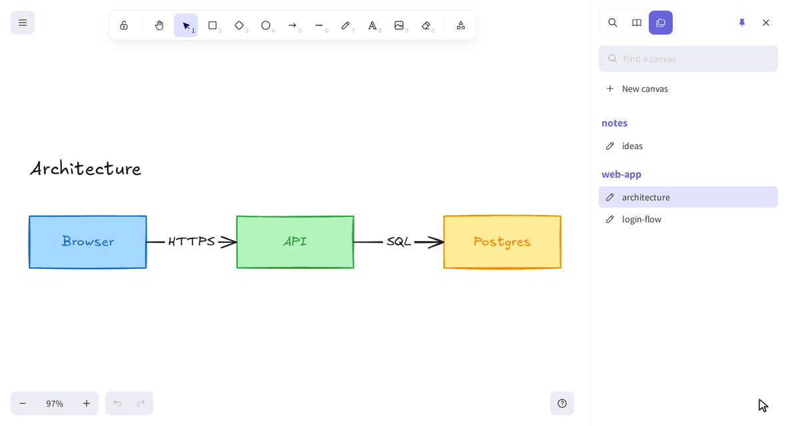

# Localidraw

**A local Excalidraw for the `.excalidraw` files in a folder.**

```sh
npx localidraw            # the current folder
npx localidraw ~/notes    # or any folder
```

Then open http://localhost:3729/.



<sub>Drawn live in Localidraw, while a script edits the file as an agent would. The pointer and the captions are added
for the recording ([tools/docs-media](tools/docs-media/README.md)).</sub>

Localidraw serves the real Excalidraw editor, full screen in your browser, on the drawings in a folder on your
machine. There's no export step and no cloud copy: what you draw is saved straight to the file.

- **Projects and canvases.** Every folder under the one you start it in that holds `.excalidraw` files is a project,
  and each file is a canvas. They're listed in a **Canvases** tab in Excalidraw's own sidebar, next to the Library,
  with a filter and **New canvas**. One canvas per diagram, rather than one endless board.
- **Saved as you draw.** Each canvas is written back to its file about a second after you stop. Opening a canvas, or
  moving around it, never writes it, so browsing leaves `git status` clean.
- **Draw alongside your coding agent.** When something else changes a file (an agent editing the JSON, a
  `git pull`), the canvas updates within a second. The change is merged per element with what you've drawn since,
  so neither of you loses work.
- **Looks like Excalidraw, because it is.** It's Excalidraw 0.18.1, the version the VS Code extension uses, so files
  stay compatible both ways. Localidraw's own additions follow Excalidraw's UI conventions
  ([docs/AESTHETIC.md](docs/AESTHETIC.md)).
- **Works offline, and only for you.** Fonts and all are in the package. It listens on 127.0.0.1 only, and refuses
  requests from other hosts and sites.

## Options

```
localidraw [folder] [--port <n>] [--open]
```

- `folder`: where the canvases are (default: the current folder). `node_modules` and dot-folders are skipped.
- `--port <n>`: the port (default 3729, which spells "DRAW" on a phone keypad, or `$PORT`).
- `--open`: open it in your browser.

The open canvas is in the URL (`?canvas=path/in/folder.excalidraw`), so you can bookmark it. Your viewport per canvas,
the theme and the sidebar are remembered by the browser, not written into the files.

## How the merge works

Every Excalidraw element has a `version` that goes up each time it changes. Localidraw remembers each element's
version as of the last time the page and the file agreed. When the file changes on disk:

- an element only the file changed takes the file's copy, even an older one (so a `git checkout` of the file sticks);
- an element both sides changed keeps the higher version (the file wins a tie);
- an element the file no longer has is removed, unless you've changed it since;
- anything you've drawn that the file doesn't know about stays.

A save carries the hash of the version it was based on. If the file has moved on in the meantime, the server refuses
the save and sends back the new version, and the page merges it before saving again. So a write on disk is never
silently overwritten.

For tools that edit canvases: bump an element's `version` when you change it (Excalidraw's own
`convertToExcalidrawElements` and `bumpVersion` do), or a simultaneous edit to it in the browser wins.

## Development

```sh
npm install
npm start            # build, then run on this checkout's folder (npm start -- ~/some/folder)
npm test             # node:test: the merge, the file rules, the server API and the docs
npm run typecheck
npm run smoke:pack   # pack, install the tarball into a temp prefix, run it, check it serves
```

See [CONTRIBUTING.md](CONTRIBUTING.md) to contribute, and [AGENTS.md](AGENTS.md) for the conventions. Security
problems: [SECURITY.md](SECURITY.md), please, not an issue.

## Licence

MIT. Localidraw bundles Excalidraw (MIT) and its fonts; see [NOTICE.md](NOTICE.md). It isn't affiliated with
Excalidraw.
